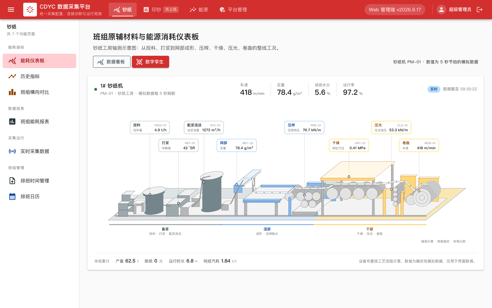
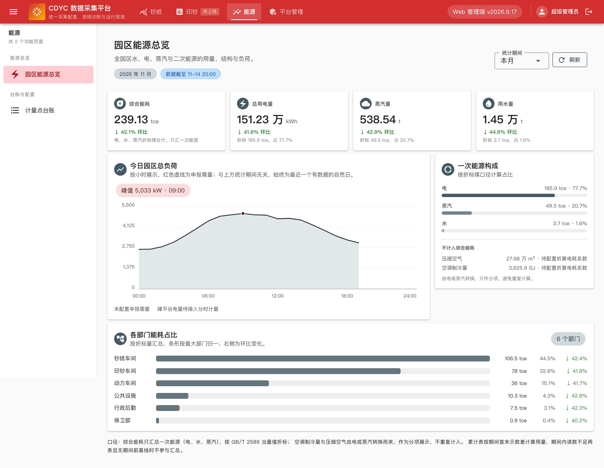
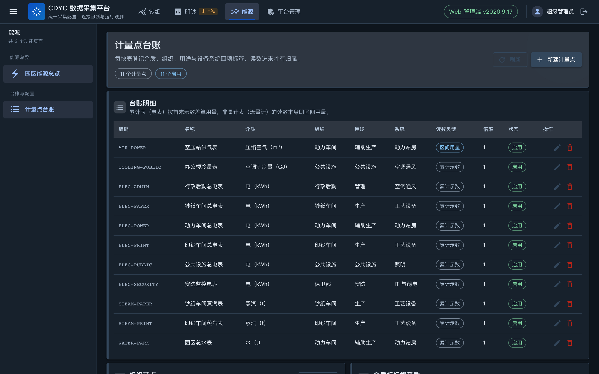

# CDYC 数据采集平台 (Data Acquisition Platform)

## 项目简介

CDYC 数据采集平台是一个基于 **.NET 10** 构建的数据采集与监控系统。该项目支持通过 Modbus、MQTT、OPC DA 等多种工业协议进行数据采集，并提供
Web（Blazor）与跨平台桌面（Avalonia）双终端展示方案。

系统支持离线部署，并在架构上考虑了分布式环境下的高可用性与负载均衡场景。

## 功能总览

| 模块       | 能力                                                                                                                            |
|------------|---------------------------------------------------------------------------------------------------------------------------------|
| 数据指标   | 钞纸班组能耗仪表板（四项原辅材料与能源指标）、历史指标（日/周/月）、班组横向对比、班组能耗报表（CSV 导出）、数字孪生视图        |
| 能源       | 园区级用能总览（介质 × 组织 × 用途 × 系统）、计量点台账、读数接入接口                                                           |
| 数据查看   | 实时采集数据、排班日历                                                                                                          |
| 业务配置   | 排班时间管理（Excel 导入与校验）                                                                                                |
| 平台管理   | 平台概览、采集服务器、点位配置、点位数据管理、服务器状态查询、History API 与 MQTT 测试工具                                      |
| 认证与权限 | 本地账号登录、域授权矩阵、页面等级与权限点、用户与角色、系统审计、部门管理员、LDAP/AD 同步、OIDC 统一登录、车间 IP 白名单免登录 |
| 桌面客户端 | Avalonia 只读客户端：能耗四页、实时采集数据、排班日历，与 Web 共用账号与接口契约                                                |

## 界面预览：钞纸机数字孪生

能耗仪表板页提供「数据看板 / 数字孪生」两个视图。孪生视图是一张等轴测的车间三维示意图：
地坪上按物料流向排开备浆（浆包、水力碎浆机、双盘磨、成浆池）、湿部（流浆箱、成形网案、压榨辊组）、
干部（烘缸组与烘罩、四辊压光、卷取与纸卷），纸幅从流浆箱唇口一路连到卷取，管线串联各段，
每个工位上方用虚线引线挂一块实时读数。视角固定，不提供旋转与缩放。

设备由三维坐标中的长方体与圆柱投影为 SVG（`Client/Components/IsoScene.cs`），离线可用。
数值当前为 5 秒节拍的确定性模拟数据（`Client/Components/PaperMachineSimulator.cs`），
接入真实工况后替换该模拟器即可。



## 界面预览：园区能源

顶栏「能源」是园区级板块，与钞纸的班组能耗并列：钞纸看工序（班组 × 四项指标 × 班次），
能源看经营（介质 × 组织 × 用途 × 系统）。同一份读数按四个维度打标，支持按用途看构成、
按组织看排名、按系统看分项。



数据链路：

| 接口                                               | 用途                                                |
|----------------------------------------------------|-----------------------------------------------------|
| `GET /api/park-energy/overview?period=month\|year` | 总览快照：指标卡、当日负荷、一次能源构成、部门占比  |
| `GET /api/park-energy/dictionary`                  | 介质 / 用途 / 设备系统 / 组织节点，打标用           |
| `POST /api/park-energy/readings`                   | 外部能源平台批量推送读数，按「编码 + 抄见时刻」幂等 |
| `GET/POST/DELETE /api/park-energy/meters`          | 计量点台账维护                                      |

推送示例（累计表填示数，流量计填本区间用量，不是瞬时速率）：

```json
{
  "readings": [
    { "meterCode": "ELEC-PAPER", "readAt": "2026-11-14T20:00:00+08:00", "value": 2711000 },
    { "meterCode": "WATER-PARK", "readAt": "2026-11-14T20:00:00+08:00", "value": 131200 }
  ]
}
```

口径：综合能耗只汇总一次能源（电、水、蒸汽），按 GB/T 2589 当量值折标；累计表按期间首末示数差
计算用量，基线取期间起点之前最后一次抄见；压缩空气与空调制冷量作为分项，不重复计入。
介质缺折标系数（例如蒸汽按焓值取值）时实物量照常展示但不进总量，页面上会明确提示。
同一总分表树的园区总量与负荷只计最高层表，部门用量取末级分表，各级总分差额单列为损耗；
分表缺读数或超过上级表时提示异常，不将未知差额当作损耗。停用计量点不会移除其历史读数，
历史汇总仍按当前台账中的归属、倍率和总分表关系计算；台账变更会影响历史口径。

开发环境首次启动会自动灌入一套种子数据（11 块计量点、两个年度的读数），走与正式环境相同的
聚合链路，页面按实测口径渲染，台账与读数都能直接编辑。种子只在空库时执行一次，重灌需清空
`energy_readings` 与 `energy_meters` 后重启，开关为 `Energy:SeedDevData`。
台账、组织节点与折标系数在 `/park-energy/meters` 维护。



## 架构设计

项目遵循领域驱动设计（DDD）和整洁架构规范，以保证高内聚和低耦合。

- **合并部署单元**：将 WebApi 接口层与 Blazor Web 宿主合并部署，简化运维复杂度，避免跨域资源共享（CORS）问题。
- **混合持久化方案 (CQRS 思想)**：
    - **写入与复杂事务**：使用 **Entity Framework Core**（搭配 PostgreSQL）处理强一致性的复杂写入操作。
    - **只读与高性能查询**：使用 **Dapper** 编写原生 SQL，满足报表统计与高并发查询的性能要求。
- **双终端，一套接口契约**：Web 与桌面端共用 `DAP.Clients` 里的 API 契约与 HTTP 实现，差异只在凭据传递方式（浏览器自动带
  Cookie，桌面端持有 `CookieContainer`）。
- **分工明确**：Web 端是唯一的「管理与配置入口」；桌面端是只读数据查看与报表查询客户端，不承载配置、写入与权限管理。
- **离线与边缘计算支持**：Web 端静态资源本地化（无需外部 CDN），现场断网时页面仍可打开，数据请求由宿主给出中文错误提示。

## 项目结构

```text
├── DAP.Core.Domain                 # 核心层：领域实体、业务接口规范
├── DAP.Core.Shared                 # 核心层：共享数据契约 (Contracts / DTOs)
├── DAP.Clients                     # 共享 API 客户端：业务契约 + HTTP 实现 + 认证（Web 与桌面共用）
├── DAP.Infrastructure              # 基础设施：PGSQL 数据库访问（EF Core 写入 + Dapper 只读）与 EF Core 迁移
├── DAP.Proxies.OpcDaProxy          # 代理服务：OPC DA 采集代理 Worker
├── DAP.Presentation.BlazorWeb      # 展示层：Blazor Web 服务端与 API 宿主 (Endpoints)
├── DAP.Presentation.BlazorWeb.Client # 展示层：Blazor WebAssembly 客户端
├── DAP.Presentation.AvaloniaApp    # 展示层：基于 Avalonia 12 的跨平台桌面应用（只读数据查看与报表）
│   ├── Themes/                     # 统一品牌色板（DapPalette.axaml）与 Semi 主题覆盖
│   ├── Navigation/                 # 顶栏模块 → 抽屉分组 → 页面的导航目录与页面工厂
│   └── Controls/                   # 自绘折线 / 柱状图控件（颜色取自色板）
├── DAP.Tests.UnitTests             # 测试：领域与基础设施单元测试
├── docs/DESIGN_SYSTEM.md           # 设计规范（强制）
├── docs/AUTH_DESIGN.md             # 认证与权限设计基线
└── AGENTS.md                       # AI 协作约束
```

## 技术栈

- **基础框架**: .NET 10.0
- **Web UI**: Blazor WebAssembly / Server，全部页面统一采用 [MudBlazor](https://mudblazor.com/) 9.12 组件库（Material
  Design 设计体系），抽屉与对话框均使用官方 `MudDialog`，间距与断点直接使用 MudBlazor 内置的 `pa-*` / `mt-*` 工具类；未引入
  Tailwind 等第三方 CSS 框架，全局样式由 `wwwroot/app.css` 的 CSS 变量驱动。
- **桌面 UI**: Avalonia
  12.1，采用 [CommunityToolkit.Mvvm](https://learn.microsoft.com/en-us/dotnet/communitytoolkit/mvvm/)
  ，结合 [Semi.Avalonia](https://semi.design/) 与 [Irihi.Ursa](https://irihi.tech/) 主题。
- **数据库**: PostgreSQL 17 (Npgsql)
- **ORM**: EF Core 10.0, Dapper 2.1
- **架构模式**: Clean Architecture, Minimal APIs

## 设计规范

全项目 UI 采用 **Material Design 3** 设计体系，整体为深色主题，Web 端与桌面端共用同一套品牌色板。

| 文档                                             | 用途                                                         |
|--------------------------------------------------|--------------------------------------------------------------|
| [`docs/DESIGN_SYSTEM.md`](docs/DESIGN_SYSTEM.md) | 强制设计规范：色板定义、语义映射、组件规范、新增页面检查清单 |
| [`AGENTS.md`](AGENTS.md)                         | AI 协作约束，改动 UI 前必读                                  |

色板权威来源：

- Web：`DAP.Presentation.BlazorWeb/wwwroot/app.css` 的 `:root` 变量
- 桌面：`DAP.Presentation.AvaloniaApp/Themes/DapPalette.axaml`

**核心约定**：项目使用 Primary / Secondary / Tertiary / Success / Warning / Error / Info 七色封闭体系，每色分 Base /
Strong / Soft / Tint 四档深度（Base 主按钮与色条、Strong 亮色强调、Soft 图标底块、Tint
表头与页头）。数值与标题一律近白，色相只出现在色条、图标、标签行等小面积元素。Web 端通过 `.platform-accent-*` 修饰类切换配色，桌面端通过
`{DynamicResource Dap*Brush}` 取色，页面中不得硬编码十六进制色值；Web 端设计风格调整须同步到桌面端。

## 本地运行指南

1. **环境准备**
    - 安装 [.NET 10.0 SDK](https://dotnet.microsoft.com/download/dotnet/10.0)
    - 安装 Node.js 22+ 与 npm（仅运行 Playwright 浏览器用例时需要；构建不依赖前端工具链）
    - 准备 PostgreSQL 与 Redis 服务环境
2. **编译解决方案**
   ```bash
   dotnet build DAP.slnx
   ```
3. **启动 Web 平台服务**
   ```bash
   # 将启动 Blazor Web 与内置 API
   dotnet run --project DAP.Presentation.BlazorWeb/DAP.Presentation.BlazorWeb.csproj
   ```
4. **启动 Avalonia 桌面客户端**
   ```bash
   dotnet run --project DAP.Presentation.AvaloniaApp/DAP.Presentation.AvaloniaApp.csproj
   ```

## 桌面客户端（只读）

桌面端定位是现场看数与出报表。它连同一套 API（`appsettings.json` 的 `Api:BaseUrl`，默认
`http://localhost:5067/`），用同一份账号登录，登录成功后由进程内的 `CookieContainer` 持有会话，关闭客户端即失效。

| 模块     | 页面         | 说明                                                                                                             |
|----------|--------------|------------------------------------------------------------------------------------------------------------------|
| 数据指标 | 能耗仪表板   | 当前班组四项指标、趋势图、透视明细，可选 3/7/14/30 天与手动指定班组                                              |
| 数据指标 | 历史指标     | 按日 / 周 / 月查看单项趋势与明细                                                                                 |
| 数据指标 | 班组横向对比 | 同口径下各班组消耗对比，标出最高与最低                                                                           |
| 数据指标 | 班组能耗报表 | 区间汇总 + 明细，可导出 CSV（UTF-8 BOM，Excel 直接打开不乱码）                                                   |
| 数据查看 | 实时采集数据 | 最新入库的采集记录，可选 50 / 100 / 200 / 500 条；刷新频率 30 秒 / 1 / 3 / 5 分钟（默认 1 分钟），可关闭自动刷新 |
| 数据查看 | 排班日历     | 每日在岗与轮休班组，可翻月与回到本月                                                                             |

桌面端不包含采集点清单、后台数据节点、采集服务器、服务器状态、排班导入、域与页面配置、账号与角色管理、审计日志等配置与写操作入口，这些能力集中在
Web 端。

实现约定：

- 页面一律继承 `PageViewModelBase`（统一 loading / 错误文案 / 刷新命令）。默认只在首次进入时拉取，切页不重复请求；需要「切回即刷新」或定时轮询的页面重写
  `OnActivatedAsync` / `OnDeactivated`，外壳在切页与登出时调用。
- 定时刷新有两处实现：实时采集数据自行重写钩子（刷新频率 30 秒 / 1 / 3 / 5 分钟，默认 1 分钟并默认开启）；四个能耗页统一继承
  `AutoRefreshPageViewModelBase`（同一组档位，默认关闭，页头「数据截至 HH:mm:ss」随每次成功加载推进）。排班日历不做自动刷新。
- Web 端对应能力在 `Client/Common/PlatformAutoRefresh.razor`：开关、频率与倒计时放在页头第二行，到点回调页面自己的静默刷新，循环在
  `DisposeAsync` 里取消。能耗四页与 `/collection-data` 共用它。
- 导航目录 `Navigation/DesktopNavigationCatalog.cs` 是菜单唯一数据源；新增页面要在目录里登记，守卫测试
  `Avalonia_Page_ViewModels_Should_Be_Registered_In_Navigation_Catalog` 会校验。
- 图表是自绘控件（`Controls/LineTrendChart.cs`、`BarCompareChart.cs`），颜色从色板资源解析，不硬编码色值。

## 登录与初始账号

平台所有页面都需要登录，未登录访问任意地址会被拦到 `/login`，登录后回到原地址。会话是服务端 Cookie（`HttpOnly` +
`SameSite=Lax`，滑动 8 小时 / 绝对 12 小时），浏览器端不保存令牌。

- 首次启动时，若库中没有任何启用状态的超级管理员，会按 `appsettings.json` 的 `Auth:BootstrapAdmin` 创建一个（默认
  `admin / Admin@123456`），并置为首次登录强制改密。
- 库中已有超级管理员时该配置被忽略，改密后的密码不会被配置覆盖。
- 生产环境使用默认密码创建超管会拒绝启动，用环境变量覆盖：
  ```bash
  Auth__BootstrapAdmin__Password='换成强口令'
  ```
- 连续输错 5 次锁定 15 分钟（`Auth:Lockout`）。超管全局唯一，启动自检发现数量不为 1 会拒绝启动。
- 设计基线见 [`docs/AUTH_DESIGN.md`](docs/AUTH_DESIGN.md)（三层收窄：职能域 → 页面等级 → 权限点）。P0–P4 均已落地：登录认证、域授权矩阵（
  `/department-grants`）、页面等级与域配置（`/domain-config`）、配置类写操作审计（`audit_logs`）、领域服务授权装饰器、车间终端 IP
  白名单免登录（`Auth:Board`，默认关闭）、用户与角色（`/user-management`）、系统审计（`/system-audit`）、部门管理员（
  `Auth:DepartmentAdmin`，默认关闭）、LDAP / AD 对接与目录同步（`Auth:Ldap`）、OIDC 统一登录（`Auth:Oidc`）。
- 账号与角色：账号必须对应员工个人，不得为班组设共享账号。角色变更与启停通常在该用户下次登录时生效；能源写操作会额外回查当前授权，撤权立即阻止写入。超管全局唯一，更换只能走「移交超管」，移交后当前会话自动登出。
- 部门管理员（`Auth:DepartmentAdmin:Enabled=true`，默认关闭）只能管本部门账号、只能授予「普通用户 /
  技术人员」，跨部门调动与移交超管只对超管开放；越权尝试写入审计（`result=failed`）。
- 审计记录配置类写操作（排班、能源、采集配置、域与页面、部门授权、账号与角色）和能源读数写入，不记查询与登录；默认保留 180
  天，由后台任务分批清理（`Auth:Audit`）。
- 车间公用电脑按 IP 白名单免登录：`Auth:Board:Enabled=true` 且客户端 IP 命中 `IpWhitelist`
  （单机地址）时自动签发只读会话，只能查看数据指标下的查看类页面；写操作与平台管理一律拒绝。

## 域账号与统一登录（可选）

两条外部身份通道都默认关闭，配置不完整会在启动时一次性列出全部错误。

**LDAP / AD**（`Auth:Ldap`）：

```jsonc
{
  "Auth": {
    "Ldap": {
      "Enabled": true,
      "Host": "dc01.cdyc.local",
      "Port": 636,
      "TransportSecurity": "Ssl",        // None 只允许回环地址，生产必须 Ssl 或 StartTls
      "BindDn": "cn=svc-dap,ou=service,dc=cdyc,dc=local",
      "BindPassword": "换成实际口令",
      "BaseDn": "dc=cdyc,dc=local",
      "UserFilter": "(sAMAccountName={0})",
      "LoginAttribute": "sAMAccountName",
      "UniqueIdAttribute": "objectGUID",
      "DisplayNameAttribute": "displayName",
      "DepartmentAttribute": "department", // 值为 departments.external_code
      "SyncFilter": "(objectClass=user)",
      "SyncIntervalMinutes": 60           // 0 = 只在手工触发时同步
    }
  }
}
```

- 平台不保存域账号密码：登录时用用户输入的密码回目录校验一次，改密页对该类账号提示「密码由目录统一管理」。
- 同步只更新姓名、邮箱、部门、启停，不覆盖手工分配的角色；目录中消失的账号只停用不删除；目录返回 0 条时整轮作废。
- 部门按 `departments.external_code` 匹配，匹配不到不自动建部门，进入「用户与角色」页底部的待处理表，由超管补登记后下次同步自动归属。

**OIDC**（`Auth:Oidc`，授权码 + PKCE）：

```jsonc
{
  "Auth": {
    "Oidc": {
      "Enabled": true,
      "Providers": [
        {
          "Code": "corp",                          // 回调路径的一部分：/api/auth/oidc/corp/callback
          "DisplayName": "集团统一登录",
          "Authority": "https://login.cdyc.com",
          "ClientId": "dap-web",
          "ClientSecret": "换成实际口令",
          "NameClaim": "name",
          "EmailClaim": "email",
          "UserNameClaim": "preferred_username",
          "DepartmentClaims": ["department"]
        }
      ]
    }
  }
}
```

- 唯一键只用 `sub`，不用邮箱或 `preferred_username`。
- 新增第二家 IdP 只需加一段 `Providers`，claim 名、部门前缀、默认角色全部可配。
- 多值部门 claim（如 `groups`）配 `DepartmentPrefix` 后按前缀挑选。

## 生产部署要点

会话稳定工作需要确认以下四项：

| 项                                      | 默认值                              | 不配置的后果                                                                          |
|-----------------------------------------|-------------------------------------|---------------------------------------------------------------------------------------|
| `Auth:DataProtection:KeyPath`           | 内容根目录下 `data-protection-keys` | 重新部署/换容器后密钥丢失，所有人同时掉线；多实例各有一把钥匙，用户在两台之间反复被踢 |
| HTTPS（Kestrel 证书或反向代理终止 TLS） | 非 Development 强制 Secure Cookie   | 纯 HTTP 部署时浏览器不回传会话 Cookie，表现为「登录成功后又回到登录页」               |
| `Auth:ForwardedHeaders`（有反向代理时） | 关闭                                | 客户端 IP 全是代理地址：车间 IP 白名单失效、限流全站共用一个桶                        |
| `Auth:Audit:RetentionDays`              | 180                                 | 不配也有默认值；设为 0 表示不清理                                                     |

密钥目录必须挂持久卷并排除在版本库之外（`.gitignore` 已排除 `**/data-protection-keys/`）。
同一把密钥还用于采集服务器凭据的落库加密（Historian 的 `ClientSecret`、设备密码等，密文带 `dp:v1:`
前缀），备份时必须与数据库一起保留；无前缀的历史值按明文使用，下一次在界面上保存时自动升级为密文。

```jsonc
{
  "Auth": {
    "DataProtection": { "KeyPath": "/var/lib/dap/keys" },
    "Cookie": { "RequireHttps": true },      // 仅物理隔离内网且无法上 TLS 时才设 false
    "ForwardedHeaders": {                     // 有反向代理时才启用，且必须列地址
      "Enabled": true,
      "KnownProxies": ["10.0.0.5"],
      "ForwardLimit": 1
    }
  }
}
```

登录与改密按客户端 IP 限流 20 次/分钟（`PlatformRateLimiting`），超限返回 429；单账号仍受「连续 5 次失败锁定 15
分钟」约束。变更类请求另有同源校验（`Origin`/`Referer`），跨站提交直接 403。

## 外部服务器配置与数据库迁移

- 外部 API 与数采服务器统一保存于 PostgreSQL 的 `server_connections` 表；地址、认证信息和 Mock 开关保存在服务器配置 JSON
  中，不依赖 `appsettings.json` 中的固定服务器地址。
- 保存后台数据定义时，平台会按“采集方式 + 连接地址”自动登记缺失服务器，并将节点绑定到对应服务器；已登记服务器的连接配置作为共享主数据，不会被任一节点覆盖。
- `20260917080800_AddServerConnections` 迁移会将已有后台数据定义中的服务器地址去重回填到 `server_connections`
  ；后续关联迁移会回填节点的服务器外键。
- 排班快照保存在 PostgreSQL 的 `shift_schedule_snapshot`，多实例共享。升级后必须先执行数据库迁移；旧版排班仅在进程内存中，无法自动迁移，请重新导入
  Excel。
- 更新数据库结构时执行：
  ```bash
  dotnet ef database update \
    --project DAP.Infrastructure/DAP.Infrastructure.csproj \
    --startup-project DAP.Presentation.BlazorWeb/DAP.Presentation.BlazorWeb.csproj
  ```

## 提交与更新日志约定

- 所有 Git 提交说明统一使用中文。
- 每次准备提交代码前，必须同步更新仓库根目录下的 `CHANGELOG.md`。
- 变更记录优先追加到 `未发布` 小节，并按 `新增 / 优化 / 修复 / 文档` 分类整理。
- 提交内容与更新日志应保持一致。
